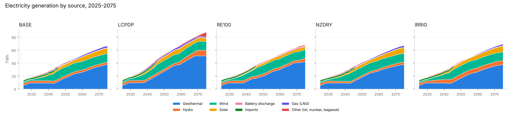
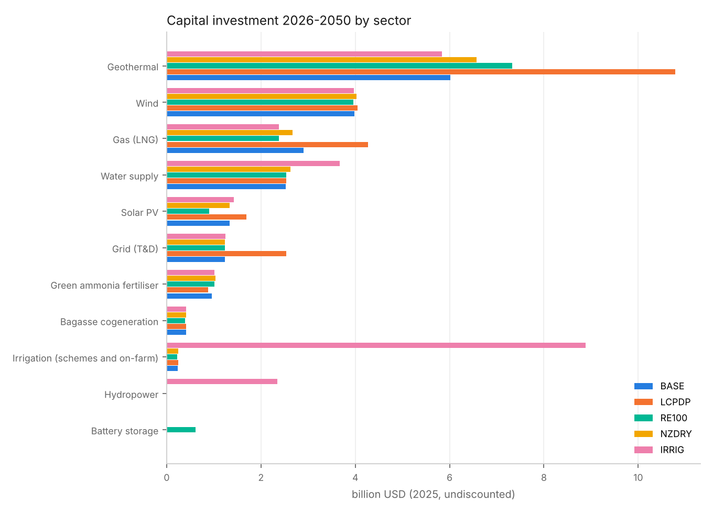
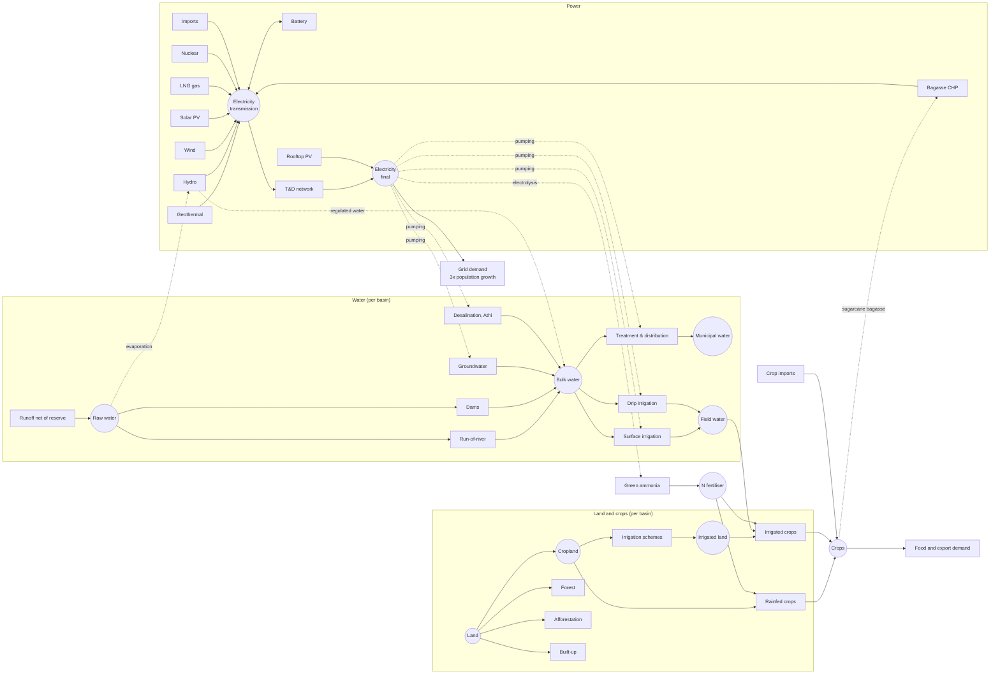
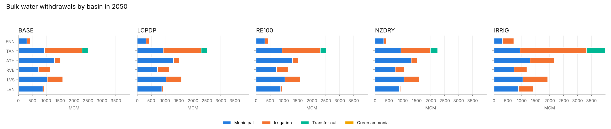

# Kenya CLEWs model (KECLEWS), 2025-2075

An open OSeMOSYS model of Kenya's Climate, Land, Energy and Water systems (CLEWs), built to answer one question for the Government of Kenya: **which energy sectors should Kenya invest in over the next 50 years**, given that the grid must meet demand growing at three times the rate of population growth, and that energy, water, land and food are tied together across the country's six water basins.

Author: Edwin Mwema Ogeto ([@DrOgeed](https://github.com/DrOgeed)). Companion to the [KEZERT road transport model](https://github.com/DrOgeed/kenya-zero-emission-road-transport).

## Key findings for investment policy

Results from five scenarios solved to optimality, 2025-2075, costs in 2025 US dollars at a 10% real discount rate. The 2025 base year reproduces EPRA FY2024/25 generation by source within 1% (total within 0.6%).

1. **Geothermal is the backbone and the single largest investment.** Least-cost capacity grows from 0.94 GW today to 1.4 GW by 2029, 2.5 GW by 2050 and 5.5 GW by 2075, supplying 42% of electricity in 2050 and 56% in 2075. It takes USD 6.0 billion of the USD 19.6 billion power, water and agriculture investment needed in 2026-2050 (BASE). With faster demand growth (LCPDP) geothermal reaches 4.0 GW by 2050 and USD 10.8 billion. Every scenario picks it, including the climate-stress case.
2. **Turkana-corridor wind is the cheapest energy and is fully used by the mid-2040s.** Wind reaches the modelled 3 GW limit of the high-wind corridor by 2046 (USD 4.0 billion), producing about a third of 2050 supply. Lower-quality wind sites are never chosen, which makes transmission to the corridor, and a better estimate of how much the corridor can host, a priority.
3. **Solar grows steadily but is held back by the evening peak.** Utility and rooftop PV reach about 2 GW by 2050 and 4 GW by 2075. Peak demand falls at 18:00-22:00, when solar produces almost nothing, so solar adds energy but not firm capacity.
4. **The real constraint is firm capacity for the evening peak, not energy.** Peak delivered load rises from 1.7 GW (2025) to 4.8 GW (2050) and 8.1 GW (2075). Beyond geothermal, the cheapest way to hold an 18% reserve margin is about 1.3 GW of fast-start gas turbines by 2035 and 3 GW by 2050, run under 4% of the year (power CO2 stays below 0.45 Mt/yr to 2050). This is reserve capacity, not baseload. Long-duration storage with contracted duration, demand response, faster geothermal drilling or a firm Ethiopian import contract could replace it, and are worth costing directly.
5. **A 100% renewable grid from 2035 (NDC 3.0) is cheap, provided firm backup is kept.** Banning fossil generation from 2035 raises total system cost by only 0.1% (USD 0.1 billion discounted). It shifts investment towards geothermal (2.9 GW by 2050) and batteries (0.5 GW), and keeps about 2.6 GW of standby turbines that never run. Without any new fossil backup the 18% reserve margin cannot be met from about 2030, because geothermal can only be drilled at 0.15-0.25 GW a year and batteries carry no firm credit in this model. Firm renewable capacity is therefore the binding issue for the NDC, not cost.
6. **Climate stress is affordable but shifts supply away from hydro.** With hydro availability down 30% and Tana, Athi, Ewaso Ng'iro and Rift Valley runoff down 15% by 2050, plus net-zero power CO2, system cost rises 3.1%. Hydro output falls from 3.5 to 2.5 TWh; geothermal and afforestation (195 kha by 2075, offsetting residual peaker emissions) fill the gap.
7. **No nuclear, no coal and no new standalone large hydro in any least-cost scenario.** At 6,000-7,000 USD/kW nuclear is never selected, even under net zero. New large hydro is not built as a power project. **High Grand Falls is built only when Tana irrigation expands** (IRRIG scenario), because its regulated water (about 1,500 MCM/yr) then has value. It is a water-and-food investment that also produces power, and should be appraised that way.
8. **Green ammonia becomes a competitive domestic fertiliser industry from the 2040s.** Electrolytic ammonia undercuts imported nitrogen from about 2040 and supplies about 250 kt N/yr by 2050 (USD 1.0 billion), using 3.7 TWh of electricity, 9% of 2050 supply. It is the largest single new link between the energy and food systems.
9. **Irrigation expansion is a food-security choice with a clear price.** Least cost does not expand irrigation: at USD 10,000/ha, irrigated maize, rice and wheat cost more than imports, so irrigated area stays near 250 kha. Forcing the NISIP target (1,000 kha of schemes by 2050, 757 kha cropped) costs USD 5.6 billion more in discounted terms (+7.2%) and USD 11.6 billion more investment to 2050. It cuts rice imports from 76% to 41% of supply. It also adds about 1.9 TWh of electricity demand in 2050 for pumping, water supply and fertiliser, triples the Tana to Athi transfer (to 666 MCM/yr) and needs High Grand Falls.
10. **Water, not energy, limits the Athi basin.** Nairobi's demand needs Athi dam yield to more than double (250 to 574 MCM/yr by 2050), full use of Athi groundwater, and the Tana transfer. Under irrigation expansion every basin draws more surface water, and Ewaso Ng'iro shifts to groundwater.

**Bottom line for investment priorities, 2026-2050 (BASE):** geothermal (USD 6.0 billion), Turkana-corridor wind plus its transmission (USD 4.0 billion), firm peaking capacity (USD 2.9 billion, technology open), water supply for Athi and Tana (USD 2.5 billion), utility and rooftop solar (USD 1.3 billion), grid expansion and loss reduction (USD 1.2 billion), green ammonia (USD 1.0 billion) and bagasse cogeneration (USD 0.4 billion).





## What the model covers

| Dimension | Detail |
|---|---|
| Framework | OSeMOSYS (GNU MathProg, `osemosys_fast.txt`), solved with HiGHS; data handled with otoole; also runs in MUIO |
| Horizon | 2025-2075, annual steps |
| Time slices | 4 seasons (Jan-Mar, Apr-Jun long rains, Jul-Sep, Oct-Dec short rains) x 3 daily brackets (night 22:00-06:00, day 06:00-18:00, evening peak 18:00-22:00) |
| Spatial | One region (KEN) with land and water tracked separately for the six Water Resources Authority basins: Lake Victoria North (LVN), Lake Victoria South (LVS), Rift Valley (RVB), Athi (ATH), Tana (TAN), Ewaso Ng'iro North (ENN) |
| Electricity | existing fleet calibrated to EPRA FY2024/25; candidates: geothermal, wind (Turkana corridor and other sites), utility and rooftop solar, batteries, large and small hydro (High Grand Falls, Karura, others), bagasse cogeneration, LNG gas turbines and combined cycle, nuclear, imports from Ethiopia and the EAPP; transmission and distribution losses; reserve margin on the evening peak |
| Water | runoff net of an ecological reserve, run-of-river abstraction, dams, groundwater within sustainable yield, municipal treatment and distribution, surface and drip irrigation, Tana to Athi transfer, desalination at Mombasa; each with its electricity use |
| Land | land balance per basin: cropland (within suitable land), irrigation schemes, protected forest, afforestation, built-up land, other crops, rangeland as the remainder |
| Crops | maize, beans, wheat, rice, potatoes, sugarcane, tea, coffee, horticulture, sorghum/millet; rainfed and irrigated, with yields, costs, fertiliser and irrigation water; imports as an alternative to domestic production |
| Links | irrigation and water supply draw on electricity; hydropower loses water to reservoir evaporation and High Grand Falls supplies regulated Tana water; sugarcane supplies bagasse for power; green ammonia turns electricity and water into fertiliser; afforestation removes CO2 |
| Size | 207 technologies, 60 commodities, about 220,000 constraints and 165,000 variables per scenario; about 4 minutes per solve with HiGHS |

### Reference energy system (simplified)



### The demand rule

Final grid demand grows each year at **3 x the UN World Population Prospects 2024 (medium variant) population growth rate for that year**. Population growth slows from 1.92% (2025) to 1.04% (2050) and 0.39% (2075), so electricity demand growth eases from 5.7% to 3.1% and 1.2%. Non-water final demand rises from 10.5 TWh (2025) to about 30.9 TWh (2050) and 52.2 TWh (2075). Electricity for water supply, irrigation, desalination and fertiliser is calculated by the model on top of this.

## Scenarios

| Scenario | Description |
|---|---|
| **BASE** | Demographic demand rule, least cost, current policy (no new coal; Ethiopia contract honoured to 2045) |
| **LCPDP** | Demand follows the LCPDP 2024-2043 Reference forecast (6.6%/yr) to 2043, then the 3x rule |
| **RE100** | NDC 3.0: 100% renewable generation from 2035 (no fossil generation, no nuclear); standby firm capacity may be kept |
| **NZDRY** | Net-zero power CO2 by 2050 (afforestation offsets allowed) plus climate stress: hydro availability down 30% by 2050, runoff down 15% in Athi, Tana, Ewaso Ng'iro and Rift Valley, rainfed yields down 10% |
| **IRRIG** | National Irrigation Sector Investment Plan: schemes reach 690 kha by 2035 and 1,000 kha by 2050, allocated by remaining basin potential, with 85% of new area cropped (maize 40%, rice 30% where rice schemes exist, horticulture the rest) |

## Scenario comparison

| | BASE | LCPDP | RE100 | NZDRY | IRRIG |
|---|---|---|---|---|---|
| Total discounted system cost (bn USD) | 78.36 | 81.73 | 78.45 | 80.80 | 83.98 |
| Change vs BASE | | +4.3% | +0.1% | +3.1% | +7.2% |
| Investment 2026-2050 (bn USD) | 19.6 | 27.4 | 20.6 | 20.2 | 31.2 |
| Generation 2050 (TWh) | 40.9 | 53.4 | 41.9 | 41.3 | 43.1 |
| Geothermal share 2050 / 2075 | 42% / 56% | 51% / 58% | 48% / 63% | 45% / 56% | 39% / 54% |
| Wind + solar share 2050 | 43% | 35% | 39% | 43% | 42% |
| Geothermal capacity 2050 (GW) | 2.5 | 4.0 | 2.9 | 2.7 | 2.5 |
| Gas turbines 2050 (GW, reserve) | 3.0 | 4.0 | 2.6 (standby) | 2.8 | 2.6 |
| Power CO2 2050 (Mt) | 0.31 | 0.65 | 0.0 | 0.0 | 0.08 |
| Irrigation schemes / cropped 2050 (kha) | 288 / 248 | 288 / 248 | 288 / 248 | 289 / 226 | 1,000 / 757 |
| Water, irrigation and fertiliser electricity 2050 (TWh) | 4.9 | 4.9 | 4.9 | 5.2 | 6.8 |
| Unserved electricity or municipal water | none | none | none | none | none |

Full tables per scenario are in [`results/summary/`](results/summary/) (generation, capacity, investment by sector and period, water supply and use by basin, crop areas, crop supply and imports, fertiliser, emissions) and the 2025 calibration in [`results/summary/calibration_2025.csv`](results/summary/calibration_2025.csv).




## Run it yourself

```bash
pip install -r requirements.txt        # otoole, highspy, pandas, matplotlib, openpyxl
sudo apt install glpk-utils            # glpsol, used to build the LP matrix
python scripts/run_scenarios.py        # build, solve and export all five scenarios (~6 min each)
python scripts/analyse_results.py      # tables in results/summary, figures in results/figures
```

To change an assumption, edit [`scripts/kenya_inputs.py`](scripts/kenya_inputs.py) (every value carries its source tag) or add a scenario in `build_model.py`, then rerun. A single scenario: `python scripts/run_scenarios.py BASE`.

## Using the model in MUIO

Two ways, for each scenario:

1. **Restore the ready-made case** `muio/KenyaCLEWs_<SCENARIO>.zip` (MUIO: Case > Upload case). This case was produced by running MUIO's own importer on the template, with time slices already mapped to seasons and daily brackets and the reserve margin entered as user-defined constraint `RM`.
2. **Import the Excel template** `muio/KenyaCLEWs_<SCENARIO>.xlsx` (MUIO: Import from template). After import, map each time slice to its season and daily bracket (names tell you: `S2P` = season 2, evening peak) and add the `RM` constraint from `muio/KenyaCLEWs_<SCENARIO>_reserve_margin_UDC.csv`.

The ready-made cases also carry what MUIO's template importer does not read: the 10% discount rate per technology (MUIO otherwise applies 5%), the day split and days-in-day-type values used by storage, and the reserve-margin constraint.

**Verified:** `python scripts/verify_muio.py BASE --solve` unpacks the case into a scratch MUIO store, lets MUIO's own code write and preprocess the data file, and solves it with MUIO's `model.v.5.7.txt`. The MUIO run is optimal with a total discounted cost of USD 78,353.9 million against 78,357.4 million in the otoole run, a difference of 0.004%. The small gap comes from MUIO's reserve margin, which is a capacity constraint against the evening peak found in the otoole run because MUIO has no `ReserveMargin` parameter.

## Repository layout

```
config/config.yaml          otoole configuration (OSeMOSYS parameter definitions)
model/osemosys_fast.txt      OSeMOSYS GNU MathProg code (with its licence)
scripts/kenya_inputs.py      every input assumption, with source tags
scripts/build_model.py       writes otoole CSVs for each scenario
scripts/solve_highs.py       HiGHS solve and solution file writer
scripts/run_scenarios.py     full pipeline
scripts/analyse_results.py   summary tables and figures
scripts/export_muio.py       MUIO template, ready-made case and reserve-margin constraint
scripts/verify_muio.py       checks a MUIO case with MUIO's own code
data/csv/<SCENARIO>/         model input data (otoole CSV)
build/<SCENARIO>.txt         GNU MathProg data files
muio/                        MUIO templates and cases
results/<SCENARIO>/          full results (annual; time-slice files regenerated on demand)
results/summary/             headline tables per scenario
results/figures/             charts
DATA_SOURCES.md              sources, assumptions and known gaps
```

## Limitations

- Land cover and crop areas by basin are allocated from county patterns, not from a GIS overlay; suitable cropland per basin is an assumption pending GAEZ v4 data.
- Water is balanced per time slice without seasonal river flow, so dry-season scarcity is understated.
- Batteries receive no firm-capacity credit because OSeMOSYS sizes storage energy separately from power; this favours firm generation and gas peaking for reserve and is the most important battery-related sensitivity.
- Fuel prices are flat in real terms; imported LNG in particular is uncertain.
- Domestic transport electrification is outside this model; the KEZERT model covers it and could be linked through electricity demand.
- Crop demand is per person constant; diet change and exports beyond the stated growth are not modelled.

See [`DATA_SOURCES.md`](DATA_SOURCES.md) for every source and gap.

## Citation

Ogeto, E. M. (2026). *Kenya CLEWs model (KECLEWS), 2025-2075: an OSeMOSYS model of energy investment under land and water constraints.* GitHub: https://github.com/DrOgeed/kenya-clews

## Licence

Code: MIT. Data and results: CC BY 4.0. OSeMOSYS model code: its own licence in `model/`.
