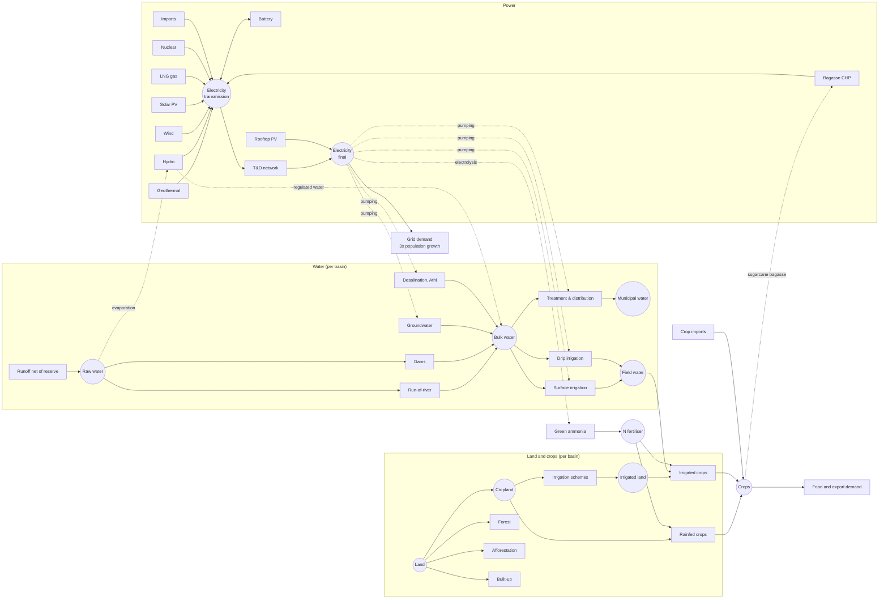

# Kenya CLEWs model (KECLEWS), 2025-2075

An open OSeMOSYS model of Kenya's Climate, Land, Energy and Water systems (CLEWs), built to answer one question for the Government of Kenya: **which energy sectors should Kenya invest in over the next 50 years**, given that the grid must meet demand growing at three times the rate of population growth, and that energy, water, land and food are tied together across the country's six water basins.

Author: Edwin Mwema Ogeto ([@DrOgeed](https://github.com/DrOgeed)). Companion to the [KEZERT road transport model](https://github.com/DrOgeed/kenya-zero-emission-road-transport).

<!-- FINDINGS -->

## What the model covers

| Dimension | Detail |
|---|---|
| Framework | OSeMOSYS (GNU MathProg, `osemosys_fast.txt`), solved with HiGHS; data handled with otoole; also runs in MUIO |
| Horizon | 2025-2075, annual steps |
| Time slices | 4 seasons (Jan-Mar, Apr-Jun long rains, Jul-Sep, Oct-Dec short rains) x 3 daily brackets (night 22:00-06:00, day 06:00-18:00, evening peak 18:00-22:00) |
| Spatial | One region (KEN) with land and water tracked separately for the six Water Resources Authority basins: Lake Victoria North (LVN), Lake Victoria South (LVS), Rift Valley (RVB), Athi (ATH), Tana (TAN), Ewaso Ng'iro North (ENN) |
| Electricity | existing fleet calibrated to EPRA FY2024/25; candidates: geothermal, wind (Turkana corridor and other sites), utility and rooftop solar, batteries, large and small hydro (High Grand Falls, Karura, others), bagasse cogeneration, LNG gas turbines and combined cycle, nuclear, imports from Ethiopia and the EAPP; transmission and distribution losses; reserve margin on the evening peak |
| Water | runoff net of an ecological reserve, run-of-river abstraction, dams, groundwater within sustainable yield, municipal treatment and distribution, surface and drip irrigation, Tana to Athi transfer, desalination at Mombasa; each with its electricity use |
| Land | land balance per basin: cropland (within suitable land), irrigation schemes, protected forest, afforestation, built-up land, other crops, rangeland as the remainder |
| Crops | maize, beans, wheat, rice, potatoes, sugarcane, tea, coffee, horticulture, sorghum/millet; rainfed and irrigated, with yields, costs, fertiliser and irrigation water; imports as an alternative to domestic production |
| Links | irrigation and water supply draw on electricity; hydropower loses water to reservoir evaporation and High Grand Falls supplies regulated Tana water; sugarcane supplies bagasse for power; green ammonia turns electricity and water into fertiliser; afforestation removes CO2 |
| Size | 201 technologies, 60 commodities, about 220,000 constraints per scenario |

### Reference energy system (simplified)



### The demand rule

Final grid demand grows each year at **3 x the UN World Population Prospects 2024 (medium variant) population growth rate for that year**. Population growth slows from 1.92% (2025) to 1.04% (2050) and 0.39% (2075), so electricity demand growth eases from 5.7% to 3.1% and 1.2%. Non-water final demand rises from 10.5 TWh (2025) to about 30.9 TWh (2050) and 52.2 TWh (2075). Electricity for water supply, irrigation, desalination and fertiliser is calculated by the model on top of this.

## Scenarios

| Scenario | Description |
|---|---|
| **BASE** | Demographic demand rule, least cost, current policy (no new coal; Ethiopia contract honoured to 2045) |
| **LCPDP** | Demand follows the LCPDP 2024-2043 Reference forecast (6.6%/yr) to 2043, then the 3x rule |
| **RE100** | NDC 3.0: 100% renewable grid from 2035 (no fossil generation, no nuclear) |
| **NZDRY** | Net-zero power CO2 by 2050 (afforestation offsets allowed) plus climate stress: hydro availability down 30% by 2050, runoff down 15% in Athi, Tana, Ewaso Ng'iro and Rift Valley, rainfed yields down 10% |
| **IRRIG** | National Irrigation Sector Investment Plan: irrigated area forced to 690 kha by 2035 and 1,000 kha by 2050 |

<!-- RESULTS -->

## Run it yourself

```bash
pip install -r requirements.txt        # otoole, highspy, pandas, matplotlib, openpyxl
sudo apt install glpk-utils            # glpsol, used to build the LP matrix
python scripts/run_scenarios.py        # build, solve and export all five scenarios (~6 min each)
python scripts/analyse_results.py      # tables in results/summary, figures in results/figures
```

To change an assumption, edit [`scripts/kenya_inputs.py`](scripts/kenya_inputs.py) (every value carries its source tag) or add a scenario in `build_model.py`, then rerun. A single scenario: `python scripts/run_scenarios.py BASE`.

## Using the model in MUIO

Two ways, for each scenario:

1. **Restore the ready-made case** `muio/KenyaCLEWs_<SCENARIO>.zip` (MUIO: Case > Upload case). This case was produced by running MUIO's own importer on the template, with time slices already mapped to seasons and daily brackets and the reserve margin entered as user-defined constraint `RM`.
2. **Import the Excel template** `muio/KenyaCLEWs_<SCENARIO>.xlsx` (MUIO: Import from template). After import, map each time slice to its season and daily bracket (names tell you: `S2P` = season 2, evening peak) and add the `RM` constraint from `muio/KenyaCLEWs_<SCENARIO>_reserve_margin_UDC.csv`.

`python scripts/verify_muio.py BASE` unpacks the case into a scratch MUIO store, makes MUIO write its data file and builds the LP with MUIO's `model.v.5.7.txt`, as a check that the case is complete.

Differences to expect between the two platforms: MUIO has no `ReserveMargin` parameter, so the reserve margin is a capacity constraint against the evening peak found in the otoole run rather than an endogenous peak; results should match closely, not exactly.

## Repository layout

```
config/config.yaml          otoole configuration (OSeMOSYS parameter definitions)
model/osemosys_fast.txt      OSeMOSYS GNU MathProg code (with its licence)
scripts/kenya_inputs.py      every input assumption, with source tags
scripts/build_model.py       writes otoole CSVs for each scenario
scripts/solve_highs.py       HiGHS solve and solution file writer
scripts/run_scenarios.py     full pipeline
scripts/analyse_results.py   summary tables and figures
scripts/export_muio.py       MUIO template, ready-made case and reserve-margin constraint
scripts/verify_muio.py       checks a MUIO case with MUIO's own code
data/csv/<SCENARIO>/         model input data (otoole CSV)
build/<SCENARIO>.txt         GNU MathProg data files
muio/                        MUIO templates and cases
results/<SCENARIO>/          full results (annual; time-slice files regenerated on demand)
results/summary/             headline tables per scenario
results/figures/             charts
DATA_SOURCES.md              sources, assumptions and known gaps
```

## Limitations

- Land cover and crop areas by basin are allocated from county patterns, not from a GIS overlay; suitable cropland per basin is an assumption pending GAEZ v4 data.
- Water is balanced per time slice without seasonal river flow, so dry-season scarcity is understated.
- Batteries receive no firm-capacity credit because OSeMOSYS sizes storage energy separately from power; this favours firm generation and gas peaking for reserve and is the most important battery-related sensitivity.
- Fuel prices are flat in real terms; imported LNG in particular is uncertain.
- Domestic transport electrification is outside this model; the KEZERT model covers it and could be linked through electricity demand.
- Crop demand is per person constant; diet change and exports beyond the stated growth are not modelled.

See [`DATA_SOURCES.md`](DATA_SOURCES.md) for every source and gap.

## Citation

Ogeto, E. M. (2026). *Kenya CLEWs model (KECLEWS), 2025-2075: an OSeMOSYS model of energy investment under land and water constraints.* GitHub: https://github.com/DrOgeed/kenya-clews

## Licence

Code: MIT. Data and results: CC BY 4.0. OSeMOSYS model code: its own licence in `model/`.
